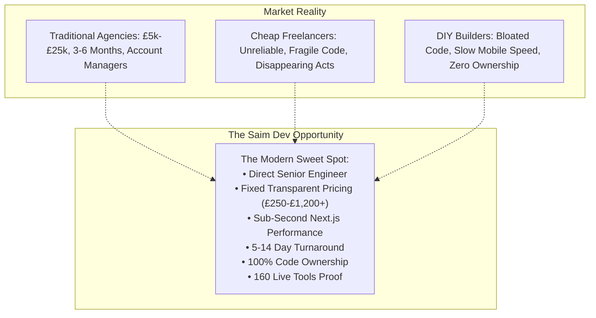

# Comprehensive Gap Analysis Matrix — Saim Dev Homepage
**Document:** `audit/homepage/gaps/gap_analysis.md`  
**Site:** `https://www.saimdev.site`  
**Date:** 02 November 2026  
**Auditor:** Senior SEO Strategist, Product Engineer & Conversion Lead  

---

## 1. The Three-Dimensional Gap Framework

---

## 2. Granular Gap Breakdown

### Dimension A: What Top Competitors Have That Saim Dev Lacked (and Our Solutions)
1. **Clear Service Categorization Across All Verticals:**
   - *Competitor Strength:* Dedicated landing sections for E-Commerce, Custom Web Apps, WordPress, Shopify, and Enterprise platforms.
   - *Previous Saim Dev Gap:* Homepage only framed services as "Next.js Websites for UK Small Businesses" and mentioned takeaways, obscuring broader technical capabilities.
   - *Our Solution:* A comprehensive 6-vertical Bento Grid on the homepage covering:
     1. Custom Web Applications & SaaS MVPs
     2. E-Commerce & Shopify Storefronts
     3. Bespoke Business Websites & Corporate Redesigns
     4. WordPress & Headless CMS Engineering
     5. High-Converting Landing Pages & CRO Funnels
     6. Website Speed Optimization & Core Web Vitals Overhauls
2. **Interactive Project Discovery / Cost Estimation:**
   - *Competitor Weakness & User Frustration:* All competitors hide pricing behind mandatory sales calls or multi-page questionnaire barriers.
   - *Our Solution:* A client-side, interactive **Project Scope & Cost Estimator** on the homepage allowing clients to select their project type, required integrations, and get an immediate, transparent cost and timeline estimate.
3. **Structured Social Proof & Portfolio Diversity:**
   - *Competitor Strength:* Visual case study cards showing diverse industries (retail, tech, B2B, healthcare).
   - *Previous Saim Dev Gap:* Focused heavily on takeaway demos.
   - *Our Solution:* Showcase multi-industry engineering proof, including real production SaaS tools, e-commerce architectures, B2B lead generation websites, and compliance platforms.

---

### Dimension B: What Saim Dev Has That Competitors Lack (Our Moats)
1. **Verifiable Engineering Depth (160 Production Interactive Web Tools):**
   - *Competitor Reality:* Competitors can show static mockups or client logos, but virtually none have built and deployed a library of 160 interactive, calculation-intensive web applications on their own domain.
   - *Our Advantage:* Real, clickable software tools (PPDS Label Generator, Allergen Matrix, Recipe Scaler, Food Cost Calculator) proving mastery of complex state management, data validation, and responsive UI engineering.
2. **Sub-Second Performance & Verified Core Web Vitals:**
   - *Competitor Reality:* Traditional agencies rely on heavy WordPress/PHP themes or unoptimized CMS stacks scoring 50–70 on mobile PageSpeed.
   - *Our Advantage:* Hand-crafted Next.js 14+ App Router architecture, zero runtime bloat, next-gen WebP/AVIF media delivery, and verified sub-second FCP and TTFB.
3. **Radical Pricing Transparency & Fixed Costs:**
   - *Competitor Reality:* Opaque quoting designed to extract the maximum budget from corporate clients, leading to scope creep and surprise billing.
   - *Our Advantage:* Published, honest fixed tiers (£250 Starter, £550 Business, £1,200+ Full Custom App/E-Commerce) with zero hidden fees and milestone guarantees.
4. **Direct Access to Senior Full-Stack Engineers:**
   - *Competitor Reality:* Communication filtered through non-technical sales reps, account managers, and junior coordinators.
   - *Our Advantage:* Direct communication with the lead software architect, eliminating translation errors and enabling rapid feature iteration.

---

### Dimension C: What Nobody in the Market Offers (The Blue Ocean Opportunity)
1. **The "Instant Scope Estimator" with Transparent Deliverables:**
   - Prospective clients hate having to talk to sales reps just to find out if they can afford an agency. Offering an instant, client-driven estimator establishes immediate trust and captures high-intent qualified leads.
2. **Complete Code Ownership with Zero Forced Maintenance Retainers:**
   - Every traditional agency pushes £200–£1,000/month recurring maintenance contracts. Saim Dev delivers 100% clean, documented, self-hostable code with complete Git repository handover and free 14–30 days post-launch support.
3. **Generative Engine Optimization (GEO) Direct-Answer Architecture:**
   - Most agency homepages are purely aspirational marketing brochures with zero concise factual definitions. Saim Dev's homepage embeds structured, direct-answer definitions for search engines and LLMs (ChatGPT, Perplexity, Gemini, Google AI Overviews) answering high-intent PAA questions with authority.
