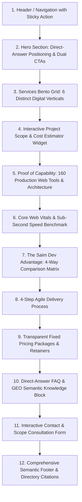

# Saim Dev Homepage Master Architecture & Engineering Blueprint
**Document:** `audit/homepage/strategy/homepage_blueprint.md`  
**Site:** `https://www.saimdev.site`  
**Version:** 2.0.0 (Full Agency Repositioning)  
**Date:** 02 November 2026  

---

## 1. Design Language & Visual System Contract
- **Color Architecture:**
  - Background: Deep Void Black (`#000000` / `#050505`) with interactive scroll-driven canvas background.
  - Card Surfaces: Solid matte dark container (`#121212`), high-contrast subtle border (`border-white/10`, `hover:border-white/20`), ambient warm orange focal glow (`#FF4A1C/[0.06]`).
  - Brand Accent: Precision Orange (`#FF4A1C`) for primary CTAs, active status indicators, and key metric callouts.
  - Typography: Clean neo-grotesque sans-serif with tight letter-spacing (`-0.03em` to `-0.04em`), white primary text (`text-white`), muted secondary body (`text-white/60` to `text-white/70`).
- **Layout Architecture:**
  - Responsive Bento Grid layout with generous padding, squircle rounded corners (`rounded-2xl` to `rounded-3xl`), consistent max-width container (`max-w-[1400px]`).
  - No bloated CSS frameworks or intrusive popups.

---

## 2. Master Section-by-Section Blueprint

---

## 3. Section Specifications

### Section 1: Navigation & Header
- **Elements:** Saim Dev Logo, Navigation Links (Services, Estimator, Pricing, Proof / Tools, Process, FAQ), Secondary CTA (`Live Demos`), Primary CTA (`Get Free Quote` / `WhatsApp Direct`).

### Section 2: Hero Section
- **H1:** `Custom Web Development & Full-Stack Digital Engineering Studio`
- **Subheadline:** `Bespoke business websites, fast e-commerce stores, WordPress & Shopify builds, and custom SaaS web applications engineered for sub-second speed, search dominance, and measurable business growth.`
- **Trust Chips:** `Sub-Second Next.js Speed` • `100% Code Ownership` • `Zero Agency Retainers` • `Launch in 5–14 Days`
- **Dual CTAs:**
  - Primary: `Start Your Project` (Smooth scroll to interactive inquiry / estimator)
  - Secondary: `Calculate Project Cost` (Scroll to instant cost estimator)

### Section 3: Services Bento Grid (6 Core Verticals)
1. **Custom Web Applications & SaaS MVPs:** Next.js, React, Node.js, PostgreSQL, Supabase, authenticated client dashboards, REST/GraphQL APIs.
2. **E-Commerce & High-Converting Storefronts:** Shopify setup, custom WooCommerce, headless commerce, stripe checkout optimization, sub-second product catalog.
3. **Bespoke Business Websites & Redesigns:** High-converting digital storefronts for professional services, B2B, healthcare, and retail businesses.
4. **WordPress & Headless CMS Engineering:** Custom WordPress themes, clean Gutenberg blocks, Sanity/Strapi headless architectures with zero theme bloat.
5. **High-Converting Landing Pages & Funnels:** Precision-engineered landing pages built for Google Ads, Meta campaigns, and high CRO.
6. **Website Speed Optimization & Ongoing Care:** Core Web Vitals remediation, sub-second caching, daily backups, security patching, and technical support.

### Section 4: Interactive Project Scope & Cost Estimator Widget
- **Interactive Controls:**
  - Step 1: Website / Product Type (Business Website, E-Commerce Store, Custom Web App / SaaS MVP, Landing Page, Redesign & Speed Fix).
  - Step 2: Key Features & Integrations (Custom CMS, User Authentication, Payment Gateway / Stripe, Booking & Scheduling System, Multi-Language, Advanced SEO & Schema).
  - Step 3: Delivery Timeline Preference (Standard 7–14 days, Express 5–7 days).
- **Dynamic Output Display:**
  - Estimated Investment Range (£)
  - Estimated Delivery Timeline (Days)
  - Core Deliverables Summary
  - Instant CTA: `Lock In This Scope & Quote`

### Section 5: Engineering Proof & Technical Architecture (160 Live Tools)
- Highlighting that Saim Dev is not a template shop, but an active software studio that built and maintains **160 production web applications and calculators** live on `saimdev.site`.
- Features interactive previews of top tools: Natasha's Law PPDS Label Generator, Commercial Food Cost Calculator, 14 Allergen Matrix, and Recipe Batch Scaler.

### Section 6: Core Web Vitals & Real Performance Benchmark
- Live benchmark display showing Saim Dev's Next.js sub-second performance (LCP < 0.8s, CLS 0.00, FID/INP < 50ms, 95+ Mobile Lighthouse score) compared to traditional bloated agency websites.

### Section 7: The Saim Dev Advantage (Comparison Matrix)
- Transparent comparison across 8 critical dimensions:
  1. Price Transparency
  2. Delivery Timeline
  3. Lead Engineer Access
  4. Code & Asset Ownership
  5. Page Load Speed
  6. Ongoing Monthly Costs
  7. Mobile Responsiveness & Polish
  8. SEO & GEO Citability Readiness

### Section 8: 4-Step Agile Delivery Process
1. **Discovery & Architecture (Day 1–2):** Project scoping, wireframes, technical stack selection, and database modeling.
2. **Design & Sprint Development (Day 3–8):** High-fidelity component design, responsive frontend engineering, backend integrations.
3. **Performance, SEO & Quality Assurance (Day 9–11):** Cross-browser testing, Core Web Vitals optimization, schema validation, security audit.
4. **Production Launch & 100% Code Handover (Day 12–14):** Custom domain routing, SSL setup, Google Search Console indexing, full Git repository transfer.

### Section 9: Transparent Fixed-Price Packages
- **Starter Website (£250):** 1–5 pages, mobile-first Next.js, sub-second speed, contact forms, basic SEO, launch in 5–7 days.
- **Professional Business (£550):** Up to 10 pages, custom CMS/WordPress integration, local SEO, schema markup, Google analytics, launch in 7–10 days.
- **Full Custom Web App & E-Commerce (£1,200+):** Full-stack web application, Shopify/WooCommerce or custom Next.js database backend, user auth, payment gateway, priority support, launch in 10–14 days.

### Section 10: GEO Direct Answers & Comprehensive FAQ
- Direct answers to high-intent questions:
  - "How much does a custom website cost in the UK?"
  - "Why should I choose Next.js instead of a standard WordPress theme?"
  - "How long does it take to build a bespoke website?"
  - "Do I own 100% of my website code and assets?"
  - "Can you redesign or fix an existing slow website?"
  - "What ongoing maintenance and support is included?"

### Section 11: High-Converting Contact & Scope Consultation
- Clean, focused form with project scope selector, budget range, and timeline options, plus direct WhatsApp link for instant technical consultation.

---

## 4. Multi-Entity JSON-LD Schema Architecture
The homepage will render:
1. `Organization`: Full company entity with `sameAs`, `logo`, `contactPoint`, and founder credentials.
2. `ProfessionalService`: Categorized under Web Development & Software Engineering with GBP pricing and UK/Global service areas.
3. `WebSite`: SearchAction and site entity.
4. `WebPage`: Canonical link and description.
5. `FAQPage`: Complete multi-question Q&A schema reflecting all direct answer FAQ entities.
6. `Service` catalog: Explicit schemas for Custom Web Development, E-Commerce Development, and Web Application Engineering.
